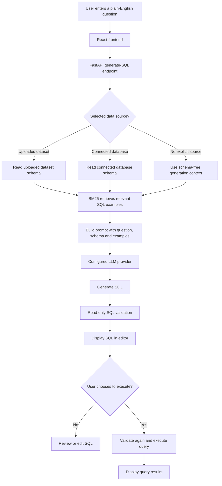

# SQL Query Generator from Plain English

An AI-powered web application that converts natural-language questions into read-only SQL, lets users review and execute the generated queries, and explains SQL in plain English. It supports uploaded CSV/Excel datasets and a sample university database, with Groq-powered generation and a lightweight BM25-based example-retrieval (RAG) workflow.

<p align="center">
  <a href="https://sql-query-generator-delta.vercel.app/">Live Application</a> ·
  <a href="https://sql-query-generator-api.onrender.com/">Backend API</a> ·
  <a href="https://sql-query-generator-api.onrender.com/docs">API Reference</a>
</p>

---

## Table of Contents

- [Project Overview](#project-overview)
- [Live Demo](#live-demo)
- [Features](#features)
- [Technology Stack](#technology-stack)
- [How the Application Works](#how-the-application-works)
- [RAG: BM25 Example Retrieval](#rag-bm25-example-retrieval)
- [Security and Query Execution](#security-and-query-execution)
- [Repository Structure](#repository-structure)
- [Run Locally](#run-locally)
- [Environment Variables](#environment-variables)
- [Supabase Setup](#supabase-setup)
- [API Overview](#api-overview)
- [Testing](#testing)
- [Deployment](#deployment)
- [Known Limitations](#known-limitations)
- [Future Enhancements](#future-enhancements)
- [Contributors](#contributors)

---

## Project Overview

SQL Query Generator from Plain English helps users who know what information they need but may not know SQL syntax. A user writes a question in everyday English, selects a database or uploads a dataset, and the application generates a corresponding SQL query.

The generated query is displayed in an editor so the user can inspect or modify it before choosing to execute it. The application also supports query explanation, error correction assistance, authentication, query history, and private uploaded-file storage.

### Problem Statement

Writing SQL requires knowledge of query syntax, joins, filtering, grouping, and database structure. This can be a barrier for students, analysts, and other users who need to retrieve data but are unfamiliar with SQL.

### Objectives

- Translate plain-English questions into SQL queries.
- Use available database or uploaded-file schema information when generating SQL.
- Provide relevant SQL examples to the language model through lightweight retrieval.
- Keep query generation separate from query execution so users can review SQL first.
- Apply read-only query validation before execution.
- Support user accounts, uploaded datasets, and query history.

## Live Demo

| Component | URL |
|---|---|
| React frontend | [https://sql-query-generator-delta.vercel.app/](https://sql-query-generator-delta.vercel.app/) |
| FastAPI backend | [https://sql-query-generator-api.onrender.com/](https://sql-query-generator-api.onrender.com/) |
| Backend health check | [https://sql-query-generator-api.onrender.com/api/health](https://sql-query-generator-api.onrender.com/api/health) |
| Interactive API documentation | [https://sql-query-generator-api.onrender.com/docs](https://sql-query-generator-api.onrender.com/docs) |

The backend is hosted on Render's free service tier. Free instances may spin down after inactivity, so the first request after an idle period can take longer while the service starts.

## Features

- **Natural-language-to-SQL generation:** Converts user questions into SQL using the configured language-model provider.
- **Schema-aware generation:** Uses metadata from the selected uploaded dataset or connected database to guide table and column selection.
- **Schema-free generation:** When no schema is supplied, the language model can generate SQL using reasonable naming assumptions. Such SQL must be checked against the intended database before execution.
- **BM25-based RAG:** Retrieves relevant examples from a curated local knowledge base and adds them to the generation prompt.
- **SQL editor:** Displays generated SQL for review and editing before execution.
- **Read-only guardrails:** Validates queries and blocks prohibited write or destructive operations and multiple statements.
- **Query execution and results:** Executes approved queries against the selected data source and displays the returned rows.
- **Plain-English explanation:** Explains the purpose and structure of a SQL query.
- **SQL error correction assistance:** Uses the model to suggest a correction when a query fails.
- **CSV and Excel uploads:** Supports spreadsheet uploads, including CSV and Excel files; the application inspects available columns for query generation.
- **Authentication and profile:** Supports sign-in, sign-up, and profile functionality through the configured authentication implementation.
- **Query history:** Provides access to a user's previous queries.
- **Light and dark themes:** Supports both interface themes.

## Technology Stack

| Layer | Technologies |
|---|---|
| Frontend | React 18, Vite 5, Tailwind CSS 3, Axios, Lucide React |
| Backend | Python, FastAPI, Uvicorn, Pydantic v2, SQLAlchemy 2 |
| SQL validation | `sqlparse` and application-level read-only validation rules |
| AI | Groq (configured model), Google Gemini provider, local fallback provider |
| Retrieval | Pure-Python Okapi BM25 over a curated SQL-example knowledge base |
| Data processing | pandas, openpyxl |
| Local/query databases | SQLite; SQLAlchemy-based database connectivity |
| Authentication and cloud storage | Supabase Auth and Supabase Storage (when configured) |
| Hosting | Vercel (frontend), Render (backend) |

## How the Application Works

The main request flow is:



### Request lifecycle

1. The user enters a question in the React interface.
2. The frontend sends the question and any selected dataset or connection identifier to the FastAPI backend.
3. The backend builds schema context from the selected data source. If no explicit source is selected, it uses schema-free generation context.
4. The RAG service searches the local SQL-example knowledge base using BM25 and returns the top relevant examples, if any.
5. The backend assembles the prompt and calls the configured LLM provider.
6. The returned SQL is passed through the application's read-only validation layer.
7. The frontend displays the query for review. Generation does not automatically execute it.
8. If the user chooses **Execute Query**, the backend validates the submitted SQL again and then executes it against the selected data source.
9. The result is returned to the frontend. Query history is recorded through the application's history service.

## RAG: BM25 Example Retrieval

The application uses example-based Retrieval-Augmented Generation (RAG). It does not need to create embeddings or download a sentence-transformer model for its current BM25 retrieval path.

### Knowledge base

The local knowledge base contains 45 curated natural-language questions and SQL patterns. The examples cover common SQL tasks such as:

- Selecting all or specific columns.
- Filtering with `WHERE`, comparisons, `IN`, `BETWEEN`, `LIKE`, and `IS NULL`.
- Sorting and limiting results with `ORDER BY`, `LIMIT`, and `OFFSET`.
- Aggregations such as `COUNT`, `SUM`, `AVG`, `MIN`, and `MAX`.
- `GROUP BY` and `HAVING`.
- Inner joins, left joins, multi-table joins, and anti-joins.
- Subqueries, common table expressions, and conditional expressions.
- Example domains such as education, HR, sales, e-commerce, and inventory.

### Retrieval workflow

1. Normalize the user's question to lowercase text.
2. Tokenize the question and filter common stop words.
3. Apply lightweight suffix normalization to improve matching of word variations.
4. Score the question against the preprocessed knowledge-base examples using Okapi BM25.
5. Rank the examples by relevance and select up to `RAG_TOP_K` examples that meet the configured minimum score.
6. Add the retrieved examples to the LLM prompt as structural and syntactic guidance.

Retrieved examples are references, not instructions to copy their table names, selected columns, filters, or row limits. The active schema and current user's question should determine the generated query.

### BM25 configuration

| Variable | Default shown in application configuration | Purpose |
|---|---:|---|
| `RAG_ENABLED` | `true` | Enables or disables retrieval. |
| `RAG_TOP_K` | `3` | Maximum number of examples retrieved for the prompt. |
| `RAG_MIN_SCORE` | `0.1` | Minimum BM25 relevance score. |

BM25 uses an in-memory index over the small local knowledge base. Retrieval does not require Supabase pgvector for this workflow.

## Security and Query Execution

The system is designed so the language model generates SQL but does not execute it directly.

- **Read-only policy:** The validator permits read-oriented queries and blocks disallowed write or destructive statements.
- **Single-statement policy:** Multiple SQL statements are rejected.
- **Separate generation and execution:** A generated query is shown to the user before execution.
- **Validation before execution:** The query is validated again when the user submits it for execution, including after manual edits.
- **Execution limits:** The backend uses configurable row and query-time limits.
- **Credential separation:** Groq and Supabase service-role secrets belong only in backend environment variables. Do not place them in frontend `VITE_` variables or commit them to Git.

Read-only validation is a safeguard, not a substitute for database-level least-privilege permissions. Use read-only database credentials wherever possible when connecting external databases.

## Repository Structure

```text
SQL-Query-Generator/
├── backend/
│   ├── app/
│   │   ├── api/                 # FastAPI routes
│   │   ├── core/                # Configuration and security utilities
│   │   ├── database/            # SQLAlchemy models and seed/schema files
│   │   ├── schemas/             # Pydantic request and response models
│   │   ├── services/            # LLM, RAG, SQL, dataset and Supabase services
│   │   └── main.py              # FastAPI application entry point
│   ├── tests/                   # Backend tests
│   ├── requirements.txt
│   └── .env.example
├── frontend/
│   ├── src/
│   │   ├── api/                 # Axios API client
│   │   ├── components/          # User-interface components
│   │   ├── App.jsx
│   │   └── main.jsx
│   ├── package.json
│   └── vite.config.js
├── data/                        # Local development database/data
├── docs/
│   ├── architecture.md
│   ├── api_contracts.md
│   └── rag_architecture.md
└── README.md
```

## Run Locally

### Prerequisites

- Python 3.10 or newer.
- Node.js 18 or newer and npm.
- Git.
- A Groq API key for Groq-powered generation. Supabase credentials are needed for the Supabase-backed features you intend to use.

### 1. Clone the repository

```bash
git clone https://github.com/hackwithprem/SQL-Query-Generator.git
cd SQL-Query-Generator
```

### 2. Set up the backend

```bash
cd backend
python -m venv .venv
```

Activate the environment:

**Windows PowerShell**

```powershell
.\.venv\Scripts\Activate.ps1
```

**macOS/Linux**

```bash
source .venv/bin/activate
```

Install backend dependencies:

```bash
pip install -r requirements.txt
```

Create a local environment file by copying the template:

**Windows PowerShell**

```powershell
Copy-Item .env.example .env
```

**macOS/Linux**

```bash
cp .env.example .env
```

Edit `backend/.env` with your own configuration. See [Environment Variables](#environment-variables). Do not commit this file.

Start the backend from the `backend` directory:

```bash
uvicorn app.main:app --reload --host 127.0.0.1 --port 8000
```

The API is available at `http://127.0.0.1:8000`. Interactive API documentation is available at `http://127.0.0.1:8000/docs`.

### 3. Set up the frontend

Open a second terminal at the repository root and run:

```bash
cd frontend
npm install
npm run dev
```

The Vite development server normally runs at `http://localhost:5173`.

For local development, configure the Vite proxy as defined in `frontend/vite.config.js`. For a separately hosted API, set `VITE_API_BASE_URL` to the backend API base URL (including `/api`) before building the frontend.

## Environment Variables

The backend reads its settings from environment variables. The exact set required depends on which features are enabled and which providers you use.

| Variable | Example / default | Purpose |
|---|---|---|
| `APP_ENV` | `development` | Environment mode. |
| `LLM_PROVIDER` | `groq` | Selects the configured language-model provider. |
| `GROQ_API_KEY` | Set privately | Groq API credential. Backend only. |
| `GROQ_MODEL` | `openai/gpt-oss-120b` | Groq model name configured in the deployed project; use a model available to your Groq account. |
| `GEMINI_API_KEY` | Optional | Google Gemini credential if Gemini is selected. Backend only. |
| `GEMINI_MODEL` | `gemini-1.5-flash` | Gemini model setting. |
| `SUPABASE_URL` | Your project URL | Supabase project URL. |
| `SUPABASE_KEY` | Your publishable/anon key | Supabase key used by the backend service. |
| `SUPABASE_SERVICE_ROLE_KEY` | Set privately if required | Supabase service-role secret. Backend only; never expose it in the browser. |
| `SUPABASE_STORAGE_BUCKET` | `private-datasets` | Supabase Storage bucket name. |
| `DATABASE_URL` | Application SQLite default | SQLAlchemy database connection URL. |
| `RAG_ENABLED` | `true` | Enables local BM25 retrieval. |
| `RAG_TOP_K` | `3` | Maximum retrieved examples. |
| `RAG_MIN_SCORE` | `0.1` | Minimum BM25 score. |
| `JWT_SECRET_KEY` | Generate a unique secret | Signing secret for the application's local JWT functionality. Backend only. |
| `JWT_ALGORITHM` | `HS256` | JWT signing algorithm. |
| `MAX_RESULT_ROWS` | `500` | Maximum rows returned by query execution. |
| `QUERY_TIMEOUT_SECONDS` | `10` | Query execution timeout setting. |
| `MAX_UPLOAD_SIZE_MB` | `15` | Upload size limit in MB. |
| `MAX_UPLOAD_ROWS` | `50000` | Upload row limit. |
| `CORS_ORIGINS` | JSON array of allowed origins | Frontend origins permitted by the backend. |

Frontend production variable:

| Variable | Example | Purpose |
|---|---|---|
| `VITE_API_BASE_URL` | `https://your-backend.onrender.com/api` | API base URL used by the Vite frontend build. |

**Important:** Vite exposes variables prefixed with `VITE_` in the client-side bundle. Only put public configuration values there. Never put `GROQ_API_KEY`, `SUPABASE_SERVICE_ROLE_KEY`, `JWT_SECRET_KEY`, or database passwords in a `VITE_` variable.

## Supabase Setup

The application can use Supabase for authentication and private uploaded-file storage, depending on the configured environment and database schema.

1. Create a Supabase project.
2. Configure `SUPABASE_URL` and `SUPABASE_KEY` in the backend environment.
3. Configure `SUPABASE_SERVICE_ROLE_KEY` only on the backend if the server-side operations require it.
4. Create a private Storage bucket named `private-datasets` if you use the uploaded-file storage integration.
5. Review and apply the SQL schema and row-level security policies in `backend/app/database/supabase_schema.sql` using the Supabase SQL Editor.
6. Configure authentication redirect URLs for the deployed frontend in Supabase Authentication settings if your sign-in flow uses redirects or email confirmation.

Use the policies in the repository's SQL schema as a starting point and verify them against your actual application flows. Do not make private uploaded data publicly readable.

## API Overview

The FastAPI application exposes routes under `/api`. The main endpoints include:

| Method | Endpoint | Purpose |
|---|---|---|
| `GET` | `/api/health` | Backend health information. |
| `POST` | `/api/auth/signup` | Register a user. |
| `POST` | `/api/auth/login` | Sign in a user. |
| `POST` | `/api/auth/logout` | Sign out. |
| `GET` | `/api/auth/me` | Get the current user's profile. |
| `POST` | `/api/generate-sql` | Generate SQL from a natural-language question. |
| `POST` | `/api/execute-sql` | Validate and execute SQL. |
| `POST` | `/api/explain-sql` | Explain a SQL query. |
| `POST` | `/api/correct-sql` | Request a suggested correction for a failed query. |
| `GET` | `/api/schema` | Retrieve schema information. |
| `GET` | `/api/history` | Retrieve query history. |
| `POST` | `/api/data/upload` | Upload a CSV or Excel dataset. |

For full request and response examples, use the interactive [API documentation](https://sql-query-generator-api.onrender.com/docs) or see [`docs/api_contracts.md`](docs/api_contracts.md).

## Testing

Run the backend tests from the repository root after activating the backend virtual environment:

```bash
python -m pytest backend/tests -v
```

Run the frontend production build:

```bash
cd frontend
npm ci
npm run build
```

Some integration tests may require valid Supabase configuration and a reachable Supabase project. Configure test credentials separately and never commit secrets.

## Deployment

The current public deployment uses Vercel for the frontend and Render for the backend.

### Backend — Render

1. Connect the GitHub repository to Render and create a **Web Service**.
2. Set the root directory to `backend`.
3. Use the build command `pip install -r requirements.txt`.
4. Use the start command:

   ```bash
   uvicorn app.main:app --host 0.0.0.0 --port $PORT
   ```

5. Add the backend environment variables in the Render dashboard. Keep all secret values out of GitHub.
6. Set `CORS_ORIGINS` to the exact production frontend origin, for example:

   ```json
   ["https://sql-query-generator-delta.vercel.app"]
   ```

7. Deploy and verify `/api/health`.

### Frontend — Vercel

1. Import the GitHub repository into Vercel.
2. Set the root directory to `frontend`.
3. Select the Vite framework preset.
4. Use `npm run build` as the build command and `dist` as the output directory.
5. Set the production environment variable:

   ```text
   VITE_API_BASE_URL=https://sql-query-generator-api.onrender.com/api
   ```

6. Deploy the frontend and test authentication, SQL generation, execution, uploads, and history.

When code is pushed to the connected production branch, Vercel and Render can automatically trigger new deployments. Confirm the deployment status in both dashboards after each push.

## Known Limitations

- Schema-free generation relies on reasonable naming assumptions. A query that generates successfully may not execute unless the target database contains matching tables and columns.
- The language model can still make mistakes. Review generated SQL and execution results before relying on them.
- The application's read-only validator blocks supported prohibited statements, but production databases should also use read-only credentials and least-privilege permissions.
- Render's free web service may spin down after inactivity. The first request after an idle period can be delayed while the service starts.
- Local SQLite files on an ephemeral hosting filesystem should not be treated as durable production storage. Use persistent managed storage for data that must survive restarts and redeployments.
- Uploads are subject to the configured size and row limits.

## Future Enhancements

Potential future improvements include:

- More comprehensive SQL intent extraction and validation for exact limits, selected columns, and sort direction.
- Broader dialect-specific SQL generation and execution tests.
- Improved observability for model latency, retrieval relevance, and API errors.
- Persistent managed database storage for production deployments.
- Additional curated RAG examples and retrieval evaluation metrics.
- More automated frontend and end-to-end tests.

## Contributors

Contributions, bug reports, and suggestions are welcome. Please open an issue or pull request in this repository.

---

**Repository:** [hackwithprem/SQL-Query-Generator](https://github.com/hackwithprem/SQL-Query-Generator)  
**Live application:** [sql-query-generator-delta.vercel.app](https://sql-query-generator-delta.vercel.app/)
