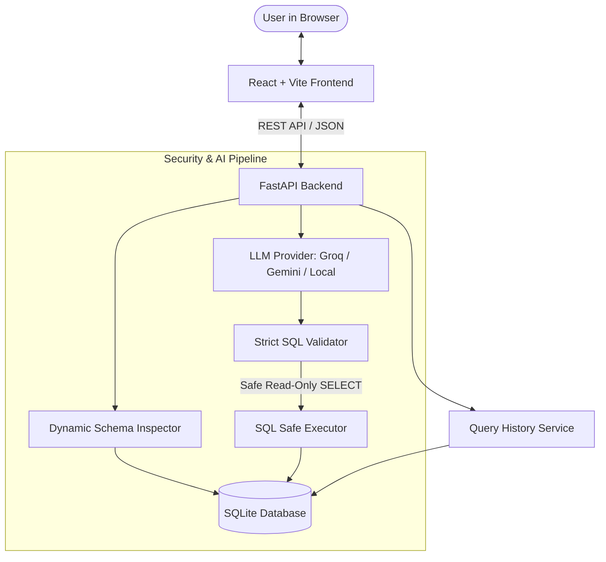

# SQL Query Generator from Plain English - System Architecture

## 1. System Overview

**SQL Query Generator from Plain English** is a full-stack, production-grade web application designed to empower students, business analysts, non-technical users, and developers to explore relational databases through natural language questions.

---

## 2. Security Architecture & Guardrails

Security is a primary design tenet. Natural language models should never be given raw write permissions to production databases.

### A. Strict Dialect-Aware Parser Validation
- Every query is parsed with `sqlparse`.
- Queries are validated against a strict read-only policy:
  - **Allowed**: `SELECT`, `WITH ... SELECT` (Common Table Expressions), and read-only `EXPLAIN`.
  - **Forbidden**: `INSERT`, `UPDATE`, `DELETE`, `DROP`, `ALTER`, `CREATE`, `TRUNCATE`, `REPLACE`, `GRANT`, `REVOKE`, `PRAGMA`, `ATTACH`, `DETACH`, `EXEC`, `EXECUTE`, `CALL`, `SELECT INTO`.
- **Single-statement enforcement**: Multiple statements separated by semicolons (e.g. `SELECT 1; DROP TABLE students;`) are rejected before execution.

### B. Execution Decoupling
- Generation and execution are separated: the LLM never executes queries directly.
- The user reviews and can edit the SQL before clicking **Execute Query**.
- Validation is re-run on the final edited query immediately before execution.

### C. Resource Boundaries
- Default row limit of 500 rows (`MAX_RESULT_ROWS`) to protect browser memory.
- Execution timeout limit (`QUERY_TIMEOUT_SECONDS`).
- Database errors are sanitized before returning to the frontend to prevent credential or internal path disclosure.

---

## 3. Technology Stack

### Frontend
- **Framework**: React 18 with Vite
- **Styling**: Tailwind CSS with custom dark and light themes
- **Icons**: Lucide React
- **HTTP Client**: Axios with configured `/api` proxy

### Backend
- **Framework**: FastAPI (Python 3.10+)
- **ASGI Server**: Uvicorn
- **ORM & Dialect Engine**: SQLAlchemy 2.0
- **Validation**: Pydantic v2 & `sqlparse`
- **Testing**: `pytest` & `httpx`

### AI Provider Abstraction
- Abstract base class `BaseLLMProvider` in `app/services/llm_provider.py`.
- **GroqProvider**: LLaMA-3.3-70B-Versatile via `groq` SDK.
- **GeminiProvider**: Gemini-1.5-Flash via `google-genai` SDK.
- **MockOfflineProvider**: Deterministic pattern matching engine for offline demonstrations and CI test environments without API keys.

---

## 4. Database Schema

The default SQLite demonstration database (`data/sample.db`) models an academic university system:

1. **`departments`**: `id`, `name`, `code`, `budget`
2. **`students`**: `id`, `first_name`, `last_name`, `email`, `age`, `gender`, `enrollment_year`, `gpa`, `department_id`
3. **`courses`**: `id`, `course_code`, `title`, `credits`, `instructor`, `department_id`
4. **`enrollments`**: `id`, `student_id`, `course_id`, `semester`, `enrollment_date`, `status`
5. **`marks`**: `id`, `enrollment_id`, `exam_type`, `score`, `max_score`, `grade`
6. **`query_history`**: `id`, `natural_query`, `generated_sql`, `executed`, `status`, `execution_time_ms`, `row_count`, `error_message`, `created_at`
