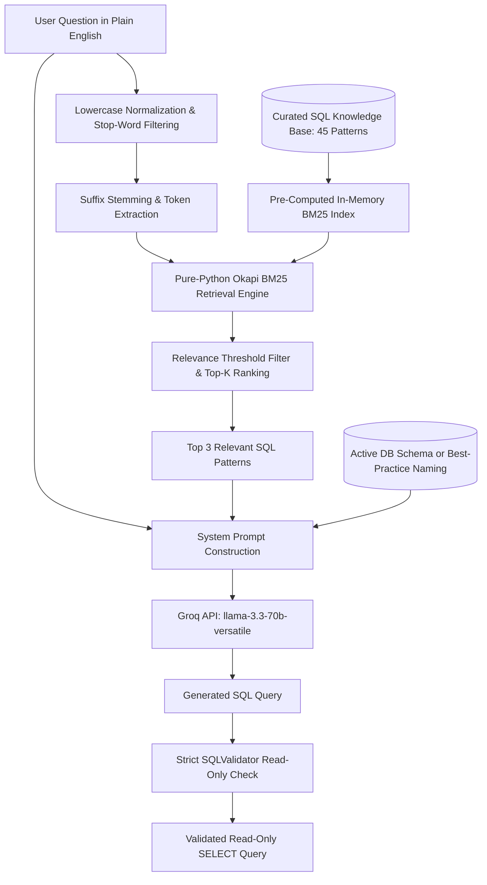

# Example-Based Retrieval-Augmented Generation (RAG) Architecture

## 1. Overview & Objective

The **SQL Query Generator from Plain English** application features an **Example-Based Retrieval-Augmented Generation (RAG)** pipeline designed specifically for high-speed, accurate SQL query synthesis on low-resource environments (such as Render's 512MB RAM free tier).

Rather than relying purely on zero-shot generation or risking schema hallucination, the RAG system dynamically identifies verified structural and syntactic SQL patterns that match the semantics of the user's plain-English question. These patterns are injected into the Groq system prompt as reference templates while explicitly anchoring the model to the user's active database schema.

To eliminate model download times, heavy PyTorch memory footprints, and avoid frontend 30-second Axios timeouts on cloud hosting, the retrieval pipeline is implemented using a **pure-Python Okapi BM25 engine** with preprocessed in-memory indexing.



---

## 2. Core Components

### A. Pure-Python BM25 Retrieval Engine
- **Algorithm**: Okapi BM25 ($k_1 = 1.5, b = 0.75$) with Lucene-compatible non-negative IDF formulation:
  $$\text{IDF}(t) = \ln\left(\frac{N - n(t) + 0.5}{n(t) + 0.5} + 1.0\right)$$
- **Zero Heavy Dependencies**: Operates exclusively with Python standard libraries (`math`, `re`, `collections.Counter`). No PyTorch, Sentence Transformers, or NumPy in the retrieval path.
- **Microsecond Latency**: The small knowledge base is indexed once in memory at startup. Query scoring takes $<0.1$ milliseconds, completely eliminating cold-start latency and timeout issues on Render free hosting.

### B. Text Normalization & Tokenization
- **Case Normalization**: All queries and document texts are lowercased.
- **Stop-Word Filtering**: Common grammatical English stop words are filtered out to emphasize substantive SQL query semantics (`students`, `products`, `average`, `group`, `marks`, `salary`, `orders`).
- **Morphological Stemming**: Lightweight suffix normalization aligns plurals and verb variations (`students` $\rightarrow$ `student`, `products` $\rightarrow$ `product`, `scored` $\rightarrow$ `scor`, `categories` $\rightarrow$ `category`).

### C. Curated Knowledge Base
- Located in [`backend/app/services/rag/knowledge_base.py`](file:///c:/Users/MY%20PC/Desktop/SQL-Query-Generator/backend/app/services/rag/knowledge_base.py).
- Contains **45 verified query patterns** across fundamental SQL operations:
  - Basic Projections & Column Selections
  - Filtering (`WHERE`, `IN`, `BETWEEN`, `LIKE`, `IS NULL`)
  - Aggregations (`COUNT`, `SUM`, `AVG`, `MIN`, `MAX`, `COUNT(DISTINCT)`)
  - Grouping & Summaries (`GROUP BY`, `HAVING`)
  - Relational Joins (`INNER JOIN`, `LEFT JOIN`, multi-table joins, anti-joins)
  - Subqueries & CTEs (`WITH ... SELECT`, correlated subqueries, scalar subqueries)
  - Conditional Expressions (`CASE WHEN`)
  - Specialized Domain Inquiries (Academic marks, sales, HR payroll, inventory)

### D. Multi-Tier Fault Tolerance & Graceful Fallback
The RAG pipeline is designed with zero-downtime fault tolerance:
1. **Pre-Indexed Memory**: The index is held in memory for immediate retrieval without network requests or external service dependencies.
2. **Relevance Threshold Guard**: If no examples meet the minimum relevance score (e.g., completely off-topic questions), RAG is bypassed cleanly.
3. **Non-Blocking Safety**: If any retrieval exception occurs, it is caught safely and query generation falls back to direct prompt generation without failing the user's request.

---

## 3. Workflow & Prompt Assembly

When a user submits a natural-language question:
1. The [`RAGService`](file:///c:/Users/MY%20PC/Desktop/SQL-Query-Generator/backend/app/services/rag/rag_service.py) normalizes and scores the question against the pre-indexed BM25 knowledge base.
2. The top-K relevant pattern examples are retrieved.
3. The retrieved examples are formatted into a dedicated section of the Groq system prompt:
   ```
   RELEVANT REFERENCE SQL PATTERNS (RETRIEVED VIA RAG):
   The following verified query patterns demonstrate effective syntax for questions similar to the user's.
   CRITICAL SCHEMA RULE: These examples are for structural and syntactic guidance ONLY.
   You MUST use table and column names matching the actual target schema (or reasonable conventions if schema-free).
   Do NOT blindly copy table or column names from these examples unless they exist in the target schema.

   --- Example 1 [domain_university_marks] (relevance: 21.80) ---
   Similar Question: List students who scored more than 80 marks in any exam
   Example SQL: SELECT DISTINCT s.id, s.first_name, s.last_name, m.score, m.grade FROM students s JOIN enrollments e ON s.id = e.student_id JOIN marks m ON e.id = m.enrollment_id WHERE m.score > 80 ORDER BY m.score DESC;
   ```
4. The LLM generates the SQL query following the provided syntactic pattern while binding strictly to the target schema.
5. The generated SQL passes through [`SQLValidator`](file:///c:/Users/MY%20PC/Desktop/SQL-Query-Generator/backend/app/services/sql_validator.py) to guarantee read-only safety before presentation in the SQL editor.

---

## 4. Configuration Variables

| Variable | Default | Purpose |
|---|---|---|
| `RAG_ENABLED` | `true` | Globally toggle RAG retrieval on/off |
| `RAG_TOP_K` | `3` | Maximum number of reference examples injected into the prompt |
| `RAG_MIN_SCORE` | `0.1` | Minimum BM25 relevance score required for an example to be included |
| `RAG_SIMILARITY_THRESHOLD` | `0.1` | Backward-compatibility alias for relevance threshold |

---

## 5. Render Deployment Advantages

- **Zero ML Model Downloads**: No 100MB+ model weights downloaded during container startup.
- **Low Memory Overhead**: Under 50MB RAM footprint, safely within Render's 512MB RAM free tier limit.
- **Fast Response Times**: Sub-millisecond retrieval eliminates the risk of hitting the frontend's 30-second Axios timeout.
