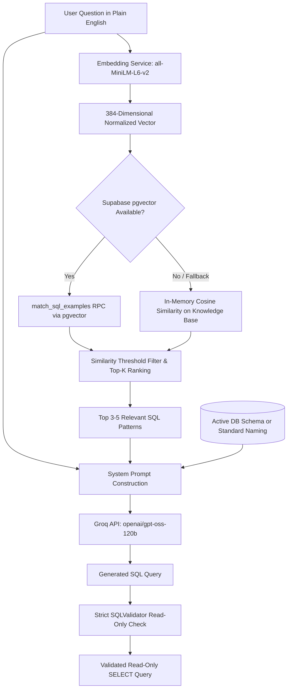

# Example-Based Retrieval-Augmented Generation (RAG) Architecture

## 1. Overview & Objective

The **SQL Query Generator from Plain English** application features an **Example-Based Retrieval-Augmented Generation (RAG)** pipeline designed specifically for SQL query synthesis.

Rather than relying purely on zero-shot generation or risking schema hallucination, the RAG system dynamically identifies verified structural and syntactic SQL patterns that match the semantics of the user's plain-English question. These patterns are injected into the LLM system prompt as reference templates while explicitly anchoring the model to the user's active database schema.



---

## 2. Core Components

### A. Embedding Model (`all-MiniLM-L6-v2`)
- **Model**: `sentence-transformers/all-MiniLM-L6-v2`.
- **Dimensions**: 384-dimensional dense vectors.
- **Normalization**: Unit $L_2$ normalization is applied to all generated vectors, enabling fast cosine distance calculation via dot products ($u \cdot v$).
- **Service**: Implemented in [`EmbeddingService`](file:///g:/Projects/SQL_Query_Generator/backend/app/services/rag/embedding_service.py) with lazy singleton loading so the backend starts immediately without startup latency.

### B. Vector Database (Supabase PostgreSQL with `pgvector`)
- **Table**: `public.sql_examples`
  - `id`: UUID Primary Key
  - `question`: Natural language question describing the query goal
  - `sql_query`: Syntactically verified read-only SQL query
  - `embedding`: `VECTOR(384)` indexed with HNSW (`vector_cosine_ops`)
  - `category`: Classification tag (e.g., `join_inner`, `group_by_having`, `cte`, `aggregate_avg`)
  - `dialect`: SQL dialect indicator (`general`, `sqlite`, etc.)
- **RPC Function**: `match_sql_examples(query_embedding, match_threshold, match_count)`
  - Calculates cosine similarity: `1 - (embedding <=> query_embedding)`
  - Filters records below `match_threshold` (default `0.4`)
  - Returns top `match_count` records ordered by highest similarity.

### C. Curated Knowledge Base
- Located in [`knowledge_base.py`](file:///g:/Projects/SQL_Query_Generator/backend/app/services/rag/knowledge_base.py).
- Contains **45 verified query patterns** across fundamental SQL operations:
  - Basic Projections & Column Selections
  - Filtering (`WHERE`, `IN`, `BETWEEN`, `LIKE`, `IS NULL`)
  - Aggregations (`COUNT`, `SUM`, `AVG`, `MIN`, `MAX`, `COUNT(DISTINCT)`)
  - Grouping & Summaries (`GROUP BY`, `HAVING`)
  - Relational Joins (`INNER JOIN`, `LEFT JOIN`, multi-table joins, anti-joins)
  - Subqueries & CTEs (`WITH ... SELECT`, correlated subqueries, scalar subqueries)
  - Conditional Expressions (`CASE WHEN`)
  - String & Date Manipulations

### D. Multi-Tier Fault Tolerance & Graceful Fallback
The RAG pipeline is designed with zero-downtime fault tolerance:
1. **Remote pgvector**: Queries Supabase via RPC if configured and available.
2. **Local Vector Search Fallback**: If Supabase credentials are not set, the remote table has not been created, or a network disruption occurs, the service automatically executes in-memory vector search over the local knowledge base using dot products.
3. **Threshold Guard**: If no examples meet the similarity threshold (e.g. for completely off-topic queries), RAG is bypassed cleanly.
4. **Non-Blocking Safety**: If any embedding or search error occurs, it is trapped and query generation falls back to prompt-only generation.

---

## 3. Workflow & Prompt Assembly

When a user submits a natural-language question:
1. The [`RAGService`](file:///g:/Projects/SQL_Query_Generator/backend/app/services/rag/rag_service.py) encodes the question into a 384-dimensional vector.
2. Cosine similarity search retrieves the top-K relevant pattern examples.
3. The retrieved examples are formatted into a dedicated section of the Groq system prompt:
   ```
   RELEVANT REFERENCE SQL PATTERNS (RETRIEVED VIA RAG):
   The following verified query patterns demonstrate effective syntax for questions similar to the user's.
   CRITICAL SCHEMA RULE: These examples are for structural and syntactic guidance ONLY.
   You MUST use table and column names matching the actual target schema (or reasonable conventions if schema-free).
   Do NOT blindly copy table or column names from these examples unless they exist in the target schema.

   --- Example 1 [aggregate_avg] (relevance: 0.91) ---
   Similar Question: Calculate the average salary of all employees
   Example SQL: SELECT ROUND(AVG(salary), 2) AS average_salary FROM employees;
   ```
4. The LLM generates the SQL query following the provided syntactic pattern while binding strictly to the target schema.
5. The generated SQL passes through [`SQLValidator`](file:///g:/Projects/SQL_Query_Generator/backend/app/services/sql_validator.py) to guarantee read-only safety before presentation in the SQL editor.

---

## 4. Configuration Variables

| Variable | Default | Purpose |
|---|---|---|
| `RAG_ENABLED` | `true` | Globally toggle RAG retrieval on/off |
| `RAG_EMBEDDING_MODEL` | `all-MiniLM-L6-v2` | Hugging Face model identifier for SentenceTransformers |
| `RAG_TOP_K` | `3` | Maximum number of reference examples injected into the prompt |
| `RAG_SIMILARITY_THRESHOLD` | `0.4` | Minimum cosine similarity required for an example to be included |

---

## 5. Database Setup & Seeding

1. **Apply Migration in Supabase**:
   Run [`backend/app/database/rag_migration.sql`](file:///g:/Projects/SQL_Query_Generator/backend/app/database/rag_migration.sql) in the Supabase SQL Editor.
2. **Seed Initial Examples**:
   Execute the seeding script to compute embeddings and populate the database:
   ```bash
   cd backend
   .\.venv\Scripts\python.exe -m app.database.seed_rag
   ```

